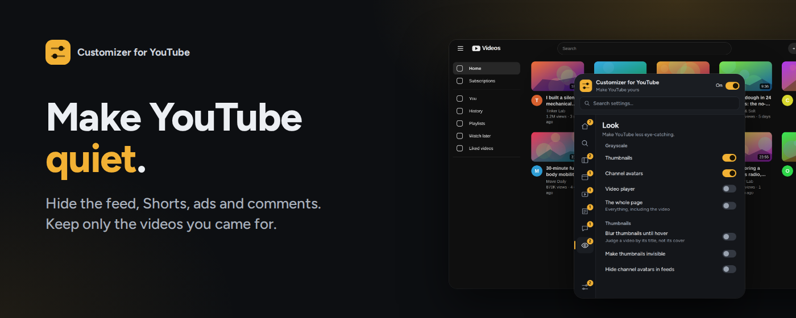
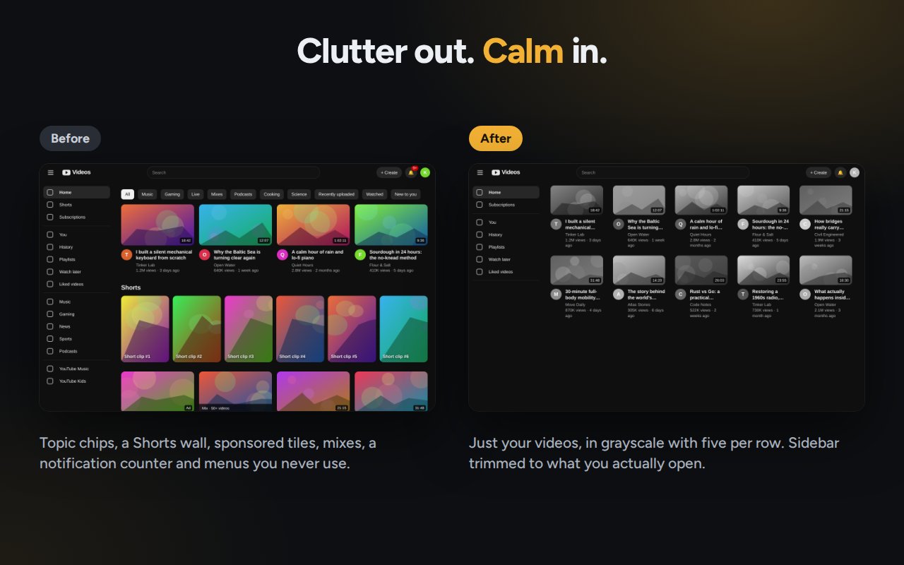
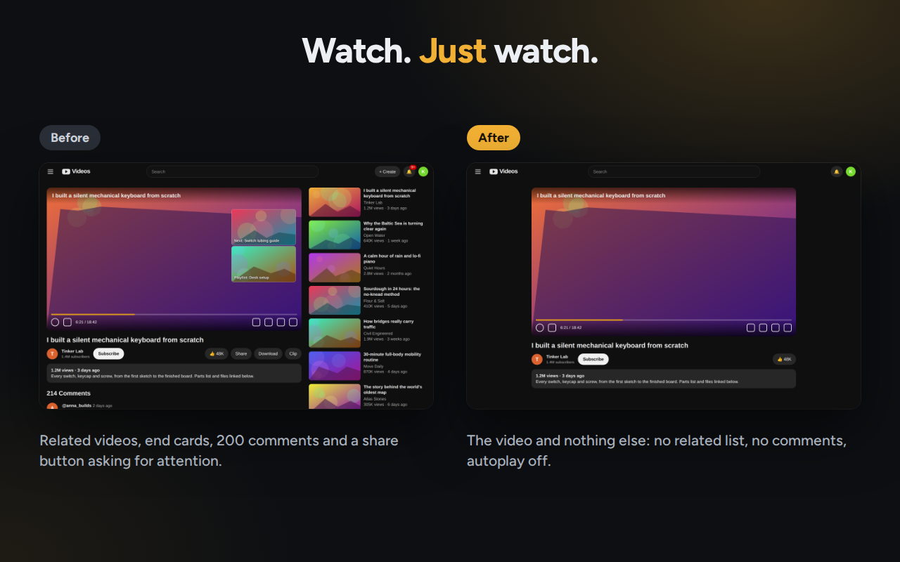
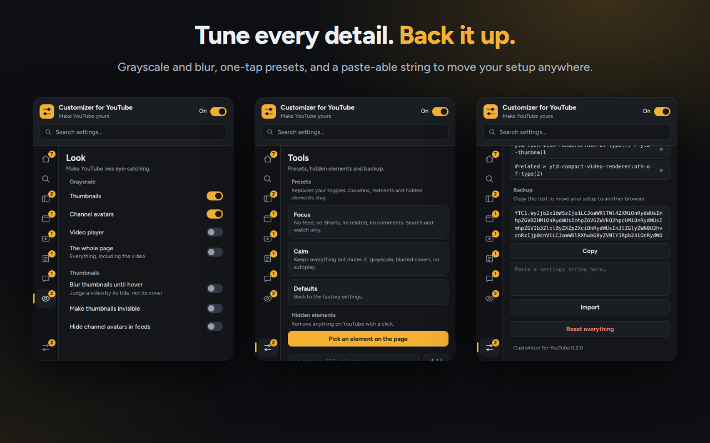

# LessTube

  

  <strong>Less clutter. More control.</strong> 
  Customize YouTube, hide distractions, and make your viewing experience your own.

  <a href="https://chromewebstore.google.com/detail/lesstube-%E2%80%94-youtube-cleane/oloemmfdfdnempbpiockejbckckjffci"><strong>Install from the Chrome Web Store</strong></a> 
  <a href="https://addons.mozilla.org/en-US/firefox/addon/lesstube-youtube-cleaner/"><strong>Install from Firefox Add-ons</strong></a> 
  <a href="#features">Features</a> ·
  <a href="#installation">Installation</a> ·
  <a href="#privacy">Privacy</a>

---

## See LessTube in action

  

  <em>A cleaner YouTube interface, tailored to your preferences.</em>

<table>
  <tr>
    <td width="50%" align="center">
      
      <strong>Customize your viewing experience</strong>
    </td>
    <td width="50%" align="center">
      
      <strong>All your settings in one place</strong>
    </td>
  </tr>
</table>

## Features

- **Hide distractions** — remove unwanted sections and interface elements.
- **Customize the layout** — adjust the video grid and number of columns.
- **Personalize the interface** — hide or restyle supported YouTube elements.
- **Element picker** — in Tools, turn on developer mode to hide an element by clicking it or by typing a CSS selector. This can break the page, so it stays off until you enable it. Already hidden elements can be removed from the same section.
- **Import and export settings** — back up and transfer your configuration.
- **Simple settings popup** — manage your preferences in one place.
- **Works with YouTube in many languages** — buttons are matched by id, URL or structure where possible. Text labels (views, dates, Share, Save and similar) also cover pl, en, de, es, fr, it, pt, ru, uk, nl, cs, tr, ja, zh, ko, hi, ar and id.
- **13 interface languages** — English, Polish, Spanish, Portuguese, German, French, Russian, Japanese, Chinese, Korean, Hindi, Arabic and Indonesian.

## Installation

### From the Chrome Web Store

[Install LessTube](https://chromewebstore.google.com/detail/lesstube-%E2%80%94-youtube-cleane/oloemmfdfdnempbpiockejbckckjffci)

### From Firefox Add-ons

[Install LessTube](https://addons.mozilla.org/en-US/firefox/addon/lesstube-youtube-cleaner/)

### Manual installation

Source files live in the project root. Browser manifests live in `chrome/manifest.json` and `firefox/manifest.json`.

To load the extension unpacked, copy the manifest for that browser into the project root as `manifest.json`, then select the project directory. Chrome reads `chrome://extensions`. Firefox reads `about:debugging`.

A store package is the same set of root files with that browser's manifest included as `manifest.json`. Leave out the other browser's folder.

Manual installation is intended for testing and development.

## Development

LessTube is built with JavaScript, CSS, HTML, and Manifest V3.

| File | Purpose |
|---|---|
| `shared.js` | Settings schema (English + Polish labels), CSS generation, import/export, and selector utilities. Loaded on YouTube and in the popup |
| `labels.js` | Words used to recognise YouTube's own buttons and text (Share, Save, views, "2 days ago" ...) in each YouTube language. Add a language here if a button is not recognised |
| `i18n.js` | Translations for the other interface languages, keyed by the English text. Popup only |
| `content.js` | YouTube DOM manipulation, redirects, and element picker |
| `style.css` | Layout and video grid styling |
| `popup.html` | Settings interface |
| `popup.css` | Popup styling |
| `popup.js` | Popup logic |
| `_locales/` | Localized interface strings |
| `fonts/` | Figtree font files |

## Privacy

LessTube uses Chrome's storage API to save user preferences. It does not make external network requests, use analytics, or load remote code.

## Compatibility

- Google Chrome 105 or newer
- Firefox 142 or newer
- Manifest V3

## License

LessTube is licensed under the MIT License.
